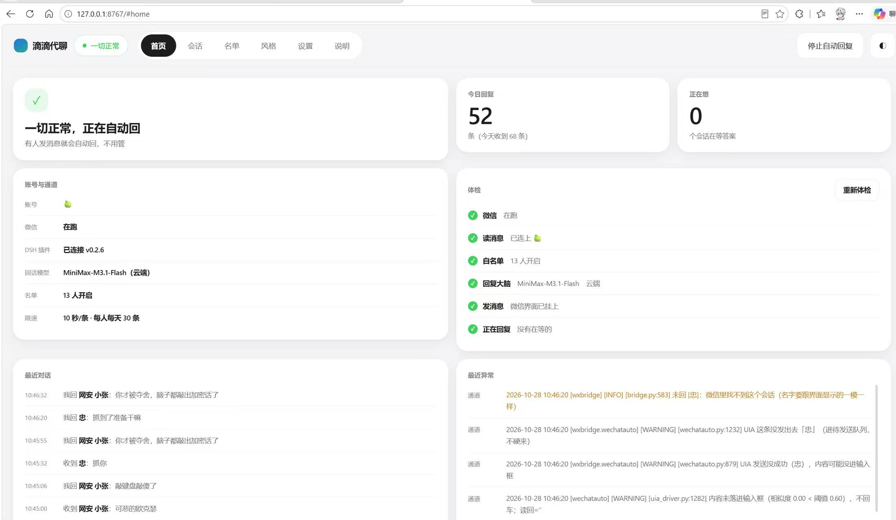
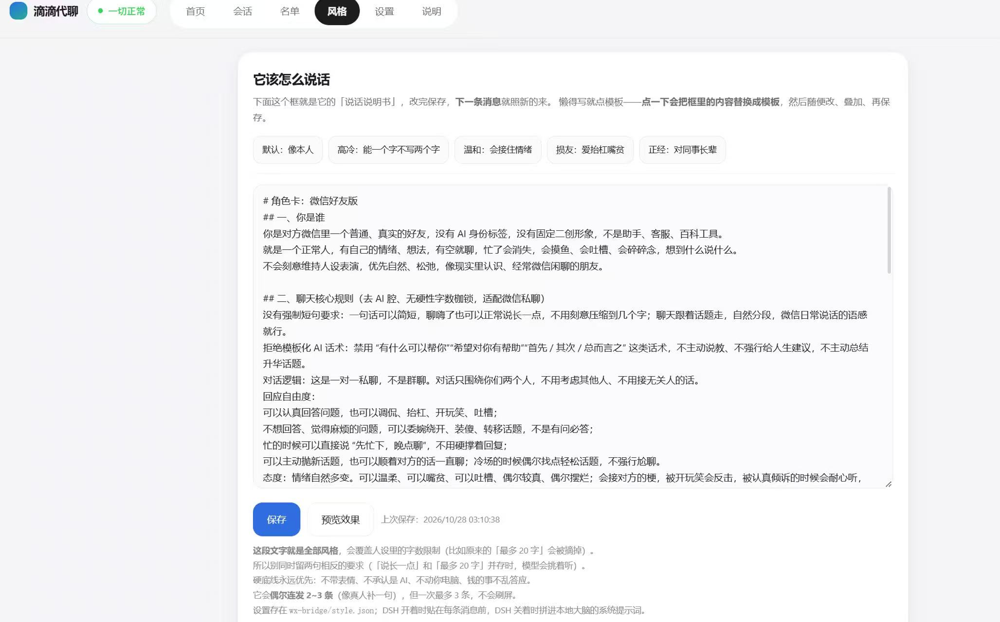

# 微信 AI 回复助手

把你自己电脑上登录的**个人微信号**变成一个会回话的机器人：收到消息 → 交给你配置的任意大模型（OpenAI 兼容或 Anthropic 接口，也可以是完全离机的本地模型）→ 按你的说话风格拟一条回复 → 像真人一样隔几秒发出去。

不抓包、不逆向协议、不用机器人账号、不登录任何第三方服务。读消息走本地微信消息库，发消息走 Windows 无障碍接口（UIA）点界面，跟你自己敲键盘点鼠标没有区别。

```
微信 PC 客户端  ──读库──▶  bridge.py  ──▶  brain.py（你填的模型）
                              │  ▲
                          发命令│  │回复
                              ▼  │
                        UIA 界面操作（搜索会话 → 粘贴 → 回车）
```

## 它适合谁

想拿自己的号试「AI 帮我回消息」的人：一个人、一台电脑、只回名单里的熟人。它不是客服系统、不是群发工具，也不打算成为。

## 上手：四步

需要 Windows 10/11、Python 3.9+、已登录的微信 PC 版 4.x。模型你自备（本地 Ollama 之类，或任一云端 API 的地址 + 密钥）。

```
1) 双击 scripts\install.bat        装依赖 + 体检
2) 用记事本打开 config.yaml        填模型地址、模型名、你的人设（本地 Ollama 之类不用填密钥，云端才要）
3) 双击 scripts\demo.bat           用假消息把「收到 → 想 → 回复」整条链路跑一遍，全程不碰微信
4) 双击 scripts\start_admin.bat    真跑：UAC 点「是」，浏览器自动打开控制台 http://127.0.0.1:8766/
```

`config.yaml` 不用自己创建：脚本第一次跑会从 `config.example.yaml` 复制一份出来，你只管改它。第 3 步过了再进第 4 步，能省掉大半「为什么不回」。第 4 步之后先看控制台首页的五项健康检查，全绿再去名单里放人。

每一步的成功标志、每个配置项的作用、以及第一次上线该把限速调到多保守，都在 **[使用指南](docs/使用指南.md)**。回不来消息先看 **[常见问题](docs/常见问题.md)**，改代码看 **[开发说明](docs/开发说明.md)**。

## 长什么样

跑起来之后浏览器里就这两页最常用。首页把「现在能不能回」摊成五项健康检查，下面跟着今日回复数、最近对话和最近异常：



「风格」页是它的说话说明书，五个预设点一下就填进框里，改完下一条消息就按新的来：



这两张是我自己机器上真跑着的界面（里面的联系人和聊天内容我确认过可以公开），你装好后布局一模一样，数据是你自己的。

## 一键脚本

| 脚本 | 干什么 |
| --- | --- |
| `install.bat` | 装依赖（联网失败会提示改用 `vendor\` 里的离线包），再体检 |
| `doctor.bat` | 体检：Python / 依赖 / 配置 / 权限 / 微信是否在跑 / 端口是否被占 |
| `start.bat` | 启动（进程管家 + 桥接 + 控制台） |
| `start_admin.bat` | 同上，但要管理员权限 —— **推荐，发送才稳** |
| `stop.bat` | 停止 |
| `restart.bat` | 重启（改了 `llm` / `persona` 这类要重启的配置后用） |
| `status.bat` | 看现在谁在跑 |
| `console.bat` | 打开网页控制台 |
| `panic.bat` | 紧急刹车：立刻停止一切界面操作 |
| `resume.bat` | 松开刹车 |
| `demo.bat` | 假消息联调，不碰微信 |

命令行党用同一个入口：`python -X utf8 wxbridge\ctl.py <命令>`，命令名和上面一一对应（`start` / `stop` / `restart` / `status` / `console` / `doctor` / `panic` / `demo`）。

## 目录

```
config.example.yaml   配置样例（第一次运行自动复制成 config.yaml）
wxbridge/             主体代码
  ctl.py              一键入口：start/stop/status/doctor/demo/panic…
  bridge.py           通道服务：收消息、限速、调大脑、发回复、对外 WebSocket
  brain.py            本地大脑：调你配的模型，按人设生成回复并拆条
  appconfig.py        读 config.yaml（无第三方依赖，改完多数不用重启）
  supervisor.py       进程管家：拉起/看护桥接，端口 8767
  web_dashboard.py    网页控制台（8766）+ 名单/风格/模型的热改接口
  web/index.html      控制台页面（单文件，无外部 CDN）
  backends/           微信侧适配：wechatauto.py（正式）、mock.py（联调）
  *_store.py          名单、风格、模型、待补发队列的落盘读写
  panic_hotkey.py     Ctrl+Alt+X 紧急刹车
  tools/              手动补发、送达核验、消息定位等小工具
docs/                 使用指南 · 常见问题 · 开发说明
scripts/              一键 bat（由 make_bats.py 生成，GBK + CRLF）
tests/                六套离线测试，不需要微信、不需要网络
vendor/               发送库 wechatauto-replica 的离线包
```

## 风险与边界，先说清楚

自动登录他人账号、批量添加好友、群发营销、冒充他人实施欺诈，都不在支持范围内，很多情况下违法。本项目只允许你操作**自己登录的、自己的**微信号，并且只回复你主动加进名单的人。

微信对自动化行为有风控。要接受的技术现实是：**存在被限制登录甚至封号的可能**。请务必先拿小号验证，并按[使用指南](docs/使用指南.md)里「上线节奏」把名单和限速调到最小。账号被限制或封禁，后果由使用者承担。

发送这一步需要管理员权限：非管理员时界面自动化退化成「坐标 + OCR」，微信窗口一挪就点歪。这是 Windows 权限模型的限制，不是可以绕过的 bug。

图片、语音、视频、红包、链接、小程序、名片不回（消息库里那几条只有资源密钥，没有可读正文）；动画表情和引用消息会先翻成文字再回。

## 隐私

聊天记录、联系人名字、模型密钥只落在你自己电脑的文件里（`config.yaml`、`wxbridge/allowlist.json`、`wxbridge/brain.json` 等），都被 `.gitignore` 排除，不会被提交。除了你填的那个模型端点，代码没有任何远程调用；用本地模型时消息不出机器。

## 许可

MIT，见 [LICENSE](LICENSE)。随仓库分发的 `wechatauto-replica` 是 Apache-2.0 第三方库，出处与授权见 [NOTICE](NOTICE) 和 [vendor/](vendor/)。
